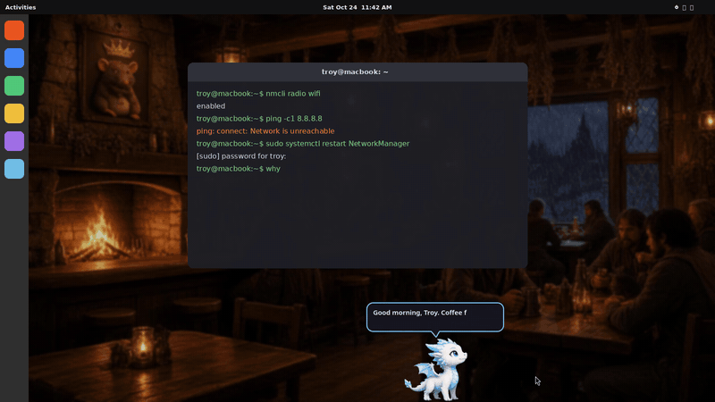

# Rimeclaw: an Emberfall desktop pet

A small white-and-blue frost dragon from Emberfall walks along the bottom of your screen. He climbs the edges, falls when you drop him, naps when you leave, and roasts you out loud. Switch pets to get **Skarn the goblin** instead.



## Install (Ubuntu / GNOME)

```bash
curl -fsSL https://raw.githubusercontent.com/tmacgoat/rimeclaw/main/install.sh | bash
```

The installer asks for your password once so it can `apt install python3-pyqt6 libxcb-cursor0`, which are Ubuntu's own packages; nothing is installed with pip. It then:
- copies the app to `~/.local/share/rimeclaw`
- adds **Rimeclaw** to your app grid
- makes him start each time you log in
- starts him right away

## Using him
- **Right-click** the pet, or use the tray icon, to open the menu: Roast me now · Rant now · Mute voice · Clean mode · Roast frequency · Switch pet · Size · Sleep · Quit
- **Drag** him around and let go to throw him. **Click** him to poke him, which he doesn't like.
- He speaks about every 7 minutes. You can change that under *Roast frequency* or set it to "Only when I ask". About 1 line in 4 is a conspiracy rant.
- He reacts when your battery is low, when you're up late, and after 2 hours of nonstop screen time. He falls asleep while you're away.
- **Clean mode** is off by default. Turn it on to get lines without swearing.
- Commands: `rimeclaw roast`, `rimeclaw rant`, `rimeclaw quit`
- Settings are saved in `~/.config/rimeclaw/settings.json`.

## Uninstall
```bash
bash ~/.local/share/rimeclaw/uninstall.sh
```

## Wayland notes
GNOME on Wayland doesn't let apps place their own windows, so Rimeclaw runs through **XWayland** (`QT_QPA_PLATFORM=xcb`). XWayland is built into Ubuntu. That is what lets him roam, stay on top of other windows and let clicks pass through him. If XWayland is missing he still runs, but in a small fixed window instead of roaming.

## Rebuilding the voice
The lines are in `tools/lines_src.py` and the voice settings in `tools/voices.json`. To rebuild:

```bash
cd tools
python3 build_lines.py
python3 render.py
```

`render.py` needs edge-tts or Kokoro.

All jokes are original. The conspiracy rants are comedy, not claims of fact.
